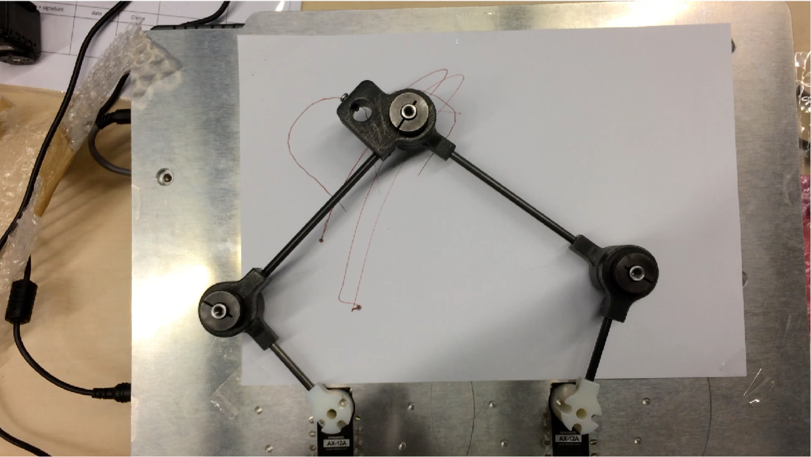

.. _pentographe:

###########################################################
 Pantographe (système 5 barres) avec Raspberry Pi et ROS2
###########################################################

   La plateforme réelle.

.. note::

   Le canevas de cette documentation provient du cours
   `Informatique industrielle avec ROS2 <https://yguel.github.io/informatique_industrielle_avec_ROS2/>`_
   de M. Manuel YGUEL (dépôt `yguel/informatique_industrielle_avec_ROS2 <https://github.com/yguel/informatique_industrielle_avec_ROS2>`_).

=====================
Description du projet
=====================

L'objectif de ces travaux pratiques est de faire fonctionner la plateforme robotique, le pantographe (système 5 barres), avec ROS2 sur un Raspberry Pi (Pi5) et de documenter le projet.

======================
Avancement du projet
======================

.. list-table::
   :header-rows: 1
   :widths: 5 45 25 25

   * - #
     - Étape
     - Responsable(s)
     - Statut
   * - 1
     - :ref:`Décrire la plateforme mécanique <mechanical_description>`
     -
     - à faire
   * - 2
     - :ref:`Décrire le matériel électronique (carte Dynamixel, datasheets) <materiel>`
     -
     - à faire
   * - 3
     - :ref:`Créer la représentation URDF <urdf>`
     -
     - à faire
   * - 4
     - :ref:`Visualiser le résultat avec RViz <visu_rviz>`
     -
     - à faire
   * - 5
     - :ref:`Décrire la dynamique et les équations de pilotage <dynamique>`
     -
     - à faire
   * - 6
     - :ref:`Créer un package ROS2 pour contrôler le pantographe <package_ros2>`
     -
     - à faire
   * - 7
     - :ref:`Créer et documenter les tests <tests>`
     -
     - à faire
   * - 8
     - :ref:`Dessiner avec le pantographe <dessin>`
     -
     - à faire
   * - 9
     - :ref:`Tester en réel <tests_reels>`
     -
     - à faire
   * - 10
     - :ref:`Créer le code de simulation <simulation>`
     -
     - à faire
   * - 11
     - :ref:`Tester en simulation (Gazebo et RViz) <tests_simulation>`
     -
     - à faire

.. toctree::
   :maxdepth: 2
   :caption: Sommaire du projet

   p50s01_material_description
   p50s02_mechanical_description
   p50s03_urdf
   p50s04_rviz
   p50s05_dynamics
   p50s06_ros2_package
   p50s07_tests
   p50s08_drawing
   p50s09_real_tests
   p50s10_simulation
   p50s11_simulation_tests
