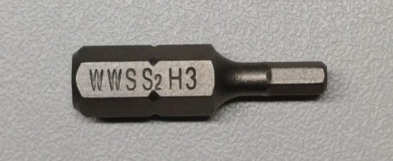
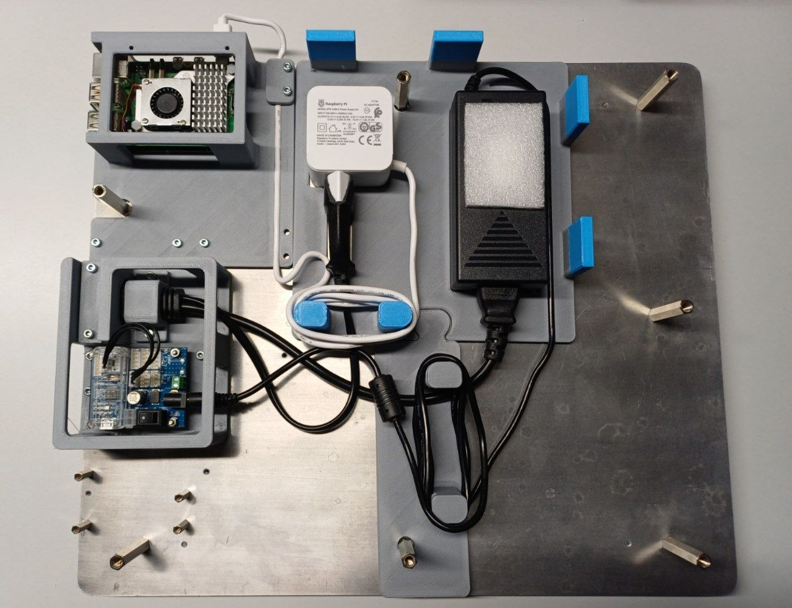
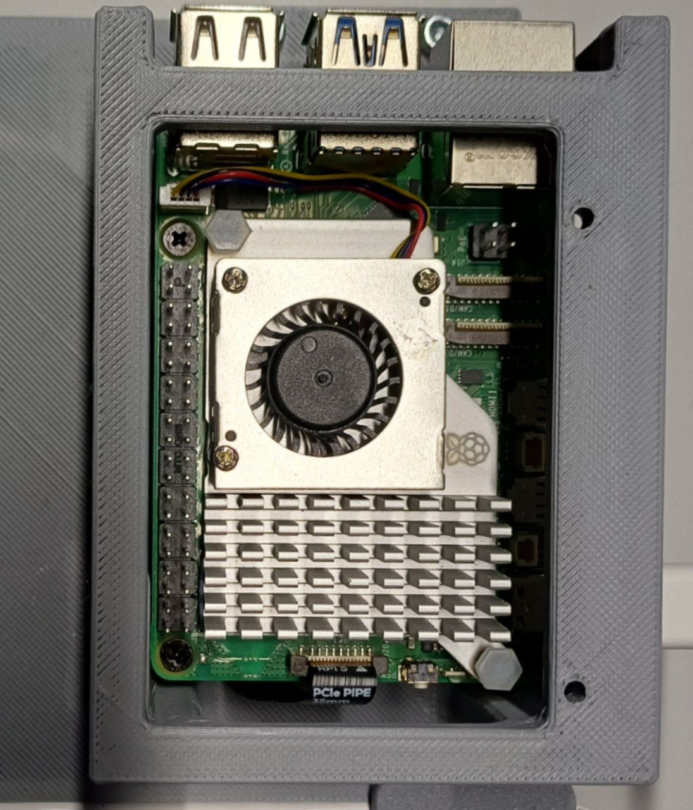
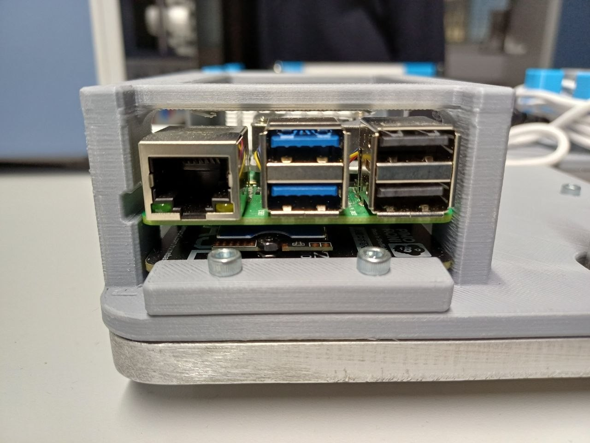
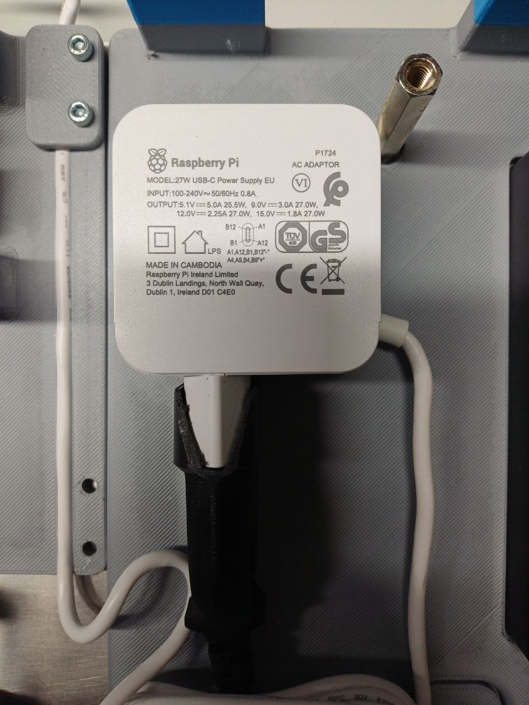
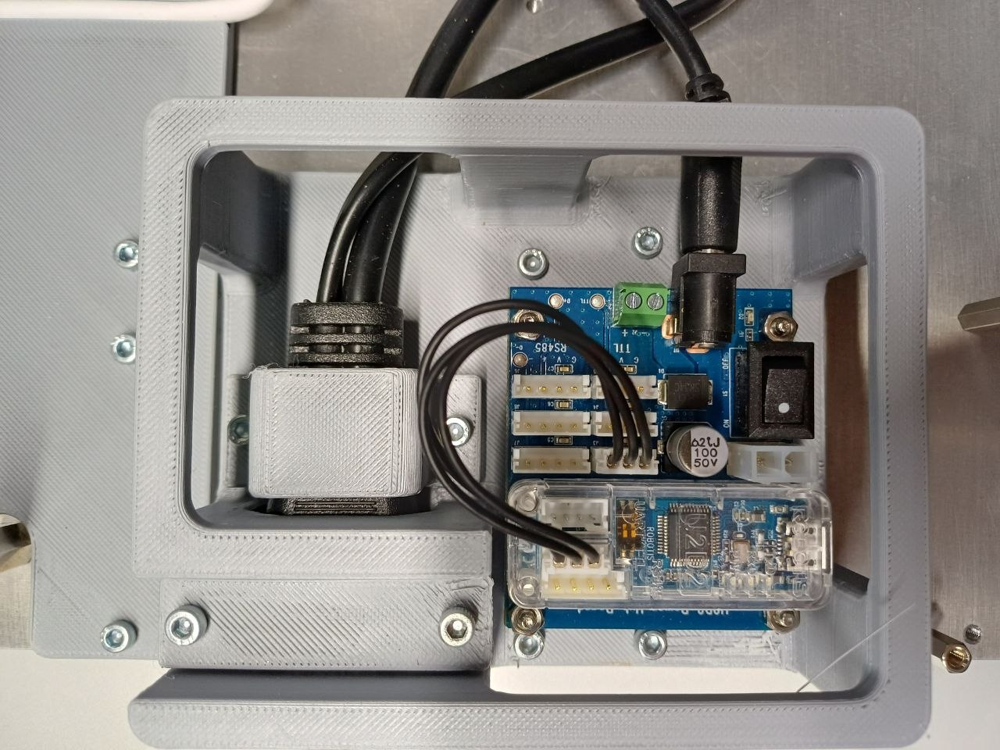
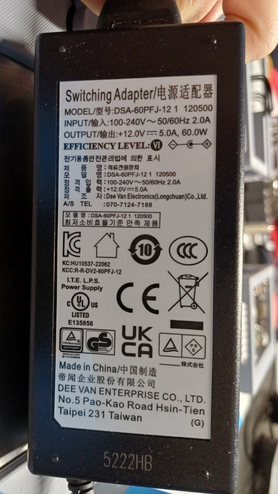
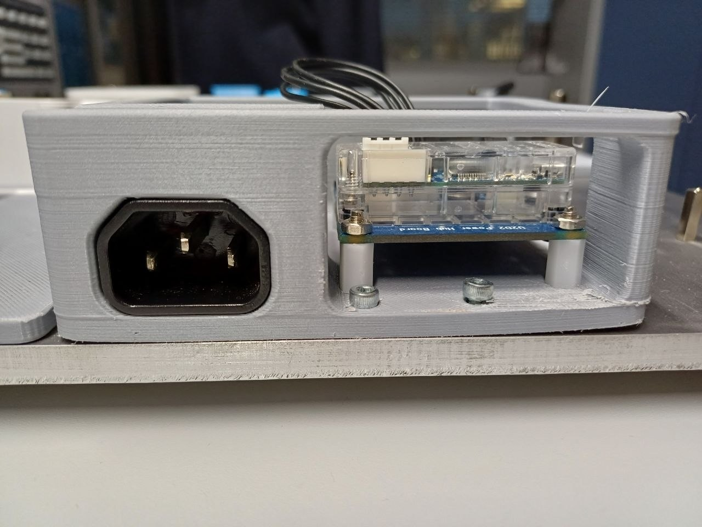

.. _materiel:

###########################################################
 Description du matériel de la plateforme système 5 barres
###########################################################

Cette page décrit le matériel électronique de la plateforme et explique comment
y accéder.

.. admonition:: Prérequis pour utiliser la maquette
   :class: important

   Pour vous connecter au Raspberry Pi et utiliser la plateforme, vous aurez
   besoin de :

   * un **écran** avec une entrée HDMI, et un **câble micro-HDMI vers HDMI**
     (le Raspberry Pi 5 possède des sorties *micro*-HDMI) ;
   * un **clavier** et une **souris** USB ;
   * le **cordon d'alimentation secteur** de la maquette (prise IEC, type « C13 » / câble d'ordinateur) ;
   * *(facultatif)* un **câble Ethernet** si vous voulez le relier au réseau.

Ouvrir le boîtier
=================

Les boîtiers sont imprimés en 3D et fermés par des vis à **six pans creux
(Allen)**. Pour les dévisser et accéder aux composants, utilisez un embout
**H3 (6 pans de 3 mm)**, par exemple la référence ``WWS S2 H3``, monté sur un
tournevis ou une visseuse.

   Embout 6 pans creux H3 (3 mm) nécessaire pour ouvrir les boîtiers.

Vue d'ensemble
==============

La plateforme regroupe, sur une plaque, quatre sous-ensembles : le Raspberry Pi
et son alimentation, l'alimentation des moteurs, et le boîtier de commande
Dynamixel.

   Vue d'ensemble de la plateforme ouverte.

La chaîne de commande est la suivante :

.. code-block:: text

   Raspberry Pi 5  --USB-->  U2D2  -->  U2D2 Power Hub Board  -->  moteurs Dynamixel AX-12A
                                              ^
                                              |
                                   alimentation 12 V (moteurs)

Le Raspberry Pi exécute ROS 2 et envoie les ordres. Le U2D2 convertit l'USB en
liaison série Dynamixel. La U2D2 Power Hub Board distribue cette liaison et
l'alimentation 12 V aux moteurs, branchés en chaîne.

Raspberry Pi 5
==============

Calculateur de la plateforme, dans un boîtier imprimé en 3D, avec un ventilateur
actif (*Raspberry Pi Active Cooler*) et une extension de stockage **Pimoroni
NVMe Base** (disque SSD).

   Le Raspberry Pi 5 avec son ventilateur et son dissipateur.

**Connectique.** Sur la façade accessible du boîtier, on trouve les ports
suivants (de gauche à droite) :

   Façade du Raspberry Pi 5 : Ethernet, 2 × USB 3.0 (bleus) et 2 × USB 2.0 (noirs).

* un port **Ethernet RJ45** (Gigabit) pour le réseau filaire ;
* deux ports **USB 3.0** (connecteurs bleus), plus rapides — à privilégier pour
  l'interface U2D2 et le stockage ;
* deux ports **USB 2.0** (connecteurs noirs), pour le clavier et la souris.

Les autres connecteurs du Raspberry Pi 5 se trouvent sur l'autre bord de la
carte : les deux sorties vidéo **micro-HDMI** et l'entrée d'alimentation
**USB-C** (voir les prérequis en haut de page).

* Documentation : `Raspberry Pi 5 <https://www.raspberrypi.com/products/raspberry-pi-5/>`__
* Extension de stockage : `Pimoroni NVMe Base <https://shop.pimoroni.com/products/nvme-base>`__
* **Alimentation** : bloc officiel **Raspberry Pi 27 W USB-C** (sortie 5,1 V / 5,0 A).

   Étiquette de l'alimentation du Raspberry Pi (27 W USB-C, 5,1 V / 5,0 A).

.. note::

   À compléter au prochain accès au robot : la quantité de RAM, le système
   installé (Ubuntu 24.04 attendu) et la version de ROS 2
   (``lsb_release -a`` ; ``printenv ROS_DISTRO``).

Interface et alimentation Dynamixel
===================================

Les moteurs sont pilotés par une interface **U2D2** (ROBOTIS) associée à une
**U2D2 Power Hub Board**. Le mains arrive par une prise IEC sur le boîtier ; un
interrupteur permet de couper l'alimentation des moteurs.

   Boîtier de commande : U2D2 (en bas) et U2D2 Power Hub Board (bleue), avec les
   connecteurs vers les moteurs et l'alimentation 12 V.

* **U2D2** : interface USB vers liaison série Dynamixel —
  `documentation <https://emanual.robotis.com/docs/en/parts/interface/u2d2/>`__
* **U2D2 Power Hub Board** : distribution de la liaison et de l'alimentation —
  `documentation <https://emanual.robotis.com/docs/en/parts/interface/u2d2_power_hub_board/>`__
* **Alimentation des moteurs** : adaptateur secteur **12 V / 5,0 A (60 W)**,
  modèle ``DSA-60PFJ-12`` (Dee Van Electronics), connecteur jack.

   Étiquette de l'alimentation 12 V des moteurs (12,0 V — 5,0 A — 60 W).

Moteurs
=======

Les deux articulations actives (:math:`A_1` et :math:`A_5`) sont entraînées par
des servomoteurs **Dynamixel AX-12A**.

* Documentation : `Dynamixel AX-12A <https://emanual.robotis.com/docs/en/dxl/ax/ax-12a/>`__

.. list-table::
   :header-rows: 1
   :widths: 40 60

   * - Caractéristique
     - Valeur
   * - Débattement
     - 300° (résolution 0,29° sur 1024 pas)
   * - Position commandée
     - entier de 0 à 1023 (0 à 300°)
   * - Protocole
     - Protocol 1.0
   * - Débit par défaut
     - 1 000 000 bps
   * - Interface
     - TTL half-duplex (3 fils)

.. important::

   Le débattement limité à 300° est une contrainte pour l'espace de travail :
   toutes les positions du crayon ne sont pas atteignables. Voir
   :ref:`l'espace de travail et les singularités <dynamique>`.

.. note::

   À compléter : les identifiants (ID) des deux moteurs et le débit réellement
   configuré, à relever avec le logiciel une fois le Raspberry Pi accessible.

Récapitulatif des alimentations
===============================

Toute la plateforme est alimentée par un **seul câble secteur**, branché sur la
prise **IEC** du boîtier (le même type de câble qu'un ordinateur) : c'est la
**seule connexion d'alimentation à brancher** pour tout mettre sous tension.

   L'unique prise secteur (IEC) de la maquette : le seul câble à brancher pour
   tout alimenter.

À l'intérieur du boîtier, ce secteur alimente **deux blocs d'alimentation
distincts** :

.. list-table::
   :header-rows: 1
   :widths: 30 25 45

   * - Alimente
     - Tension / courant
     - Référence
   * - Raspberry Pi 5
     - 5,1 V / 5,0 A (27 W)
     - bloc officiel Raspberry Pi 27 W USB-C
   * - Moteurs (via U2D2 Power Hub)
     - 12,0 V / 5,0 A (60 W)
     - DSA-60PFJ-12
